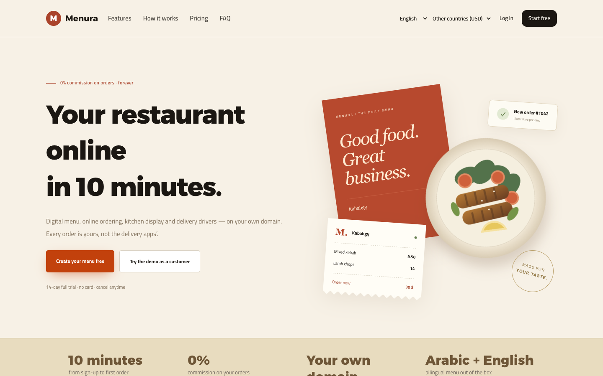
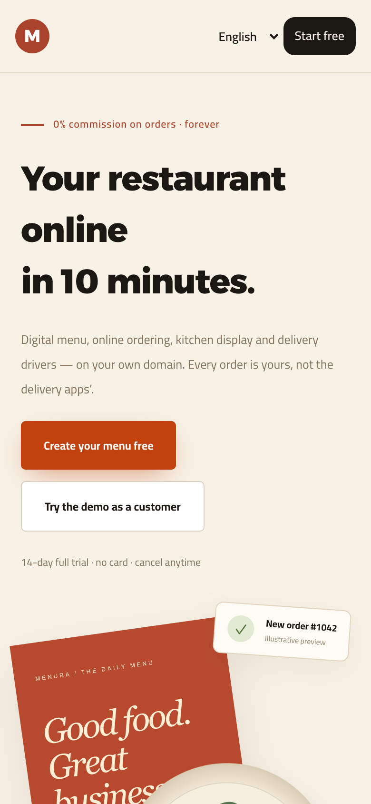
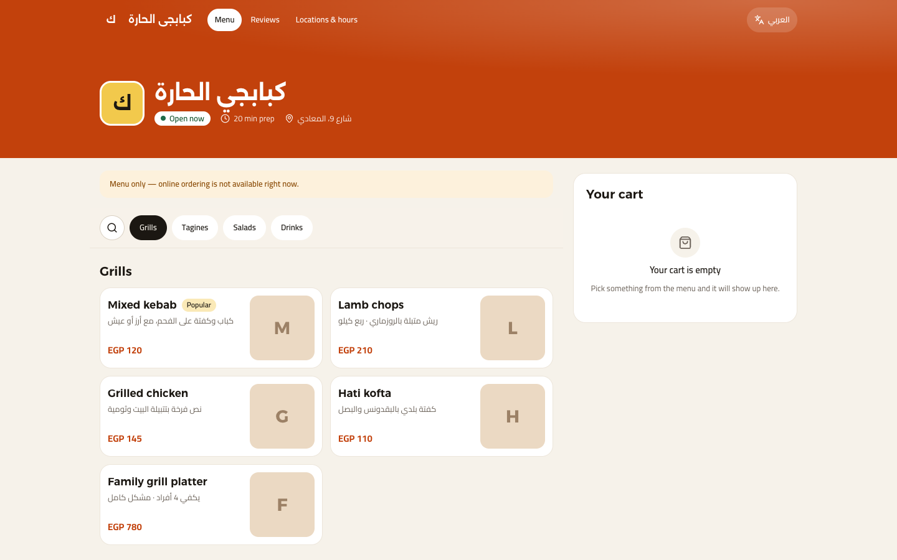
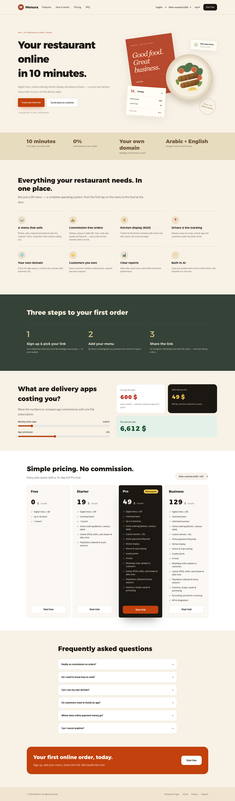

# Menura

> Restaurant SaaS: digital menu, online ordering, POS, inventory and accounting.

**Live:** [menura.virvib.com](https://menura.virvib.com/) · **Role:** Architect & developer · **Period:** 2026 · **For:** Own product

        

## Overview

Every restaurant gets a free subdomain (for example kababgy.menura…) or connects its own domain, then runs its storefront, online orders, POS, inventory and books from one platform.

## What it does

- Branded storefront and digital menu per restaurant
- Online ordering with coupons, loyalty and delivery zones
- POS with shifts and tenders, live orders over websockets
- Inventory, recipes, suppliers and purchase orders
- Double-entry accounting and reports
- Reservations, reviews, multi-branch and multi-language

## Engineering highlights

- Hybrid multi-database: central DB + one database per restaurant
- Custom domains with DNS verification and on-demand TLS certificates
- All prices recalculated on the server in minor units (no client-side money)
- Idempotent ledger postings; corrections are reversals, never edits
- Feature tests for tenant isolation, ordering, POS and payments

## Screenshots (live site)

  
  

Full home page

---

Source code is private (client / commercial project). This repository documents the work only.

Built by **Ahmed Gamal** — Senior Laravel Developer · [LinkedIn](https://www.linkedin.com/in/wzcoder/) · [GitHub](https://github.com/ahmed-gamal-dev)
